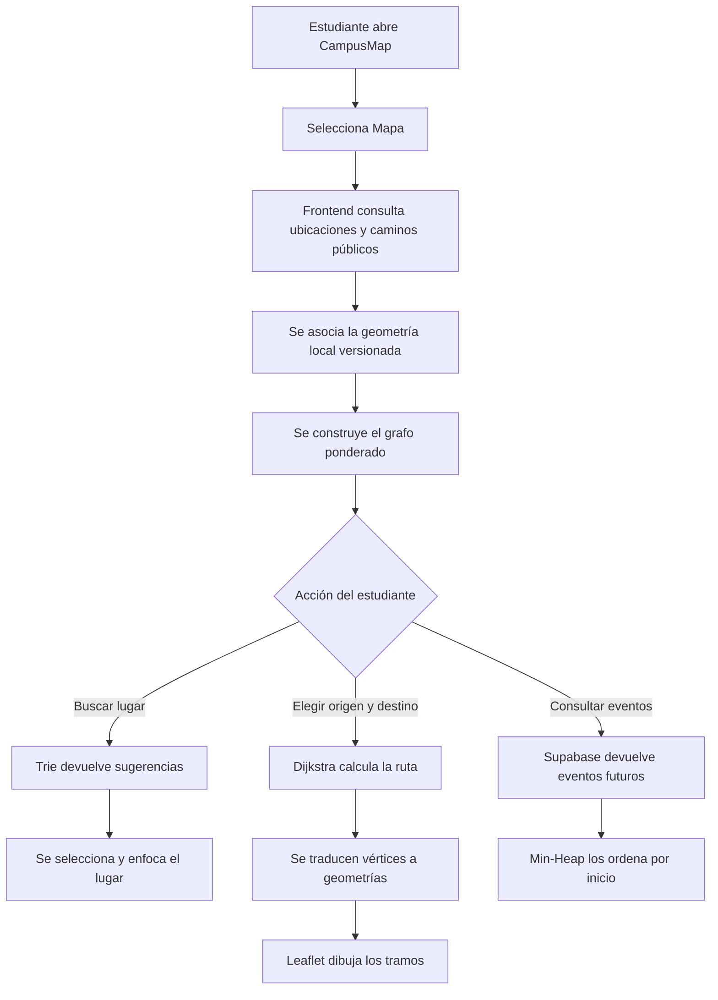
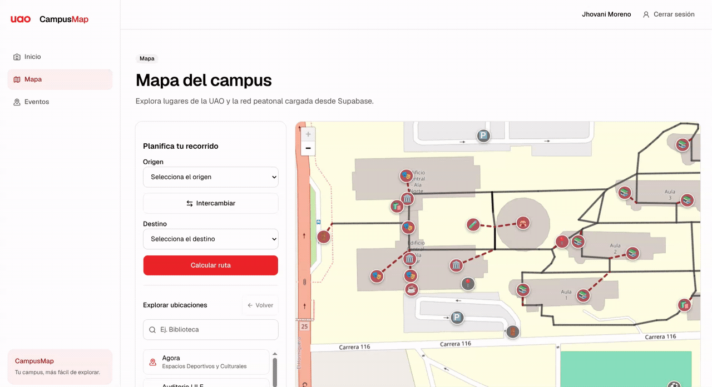
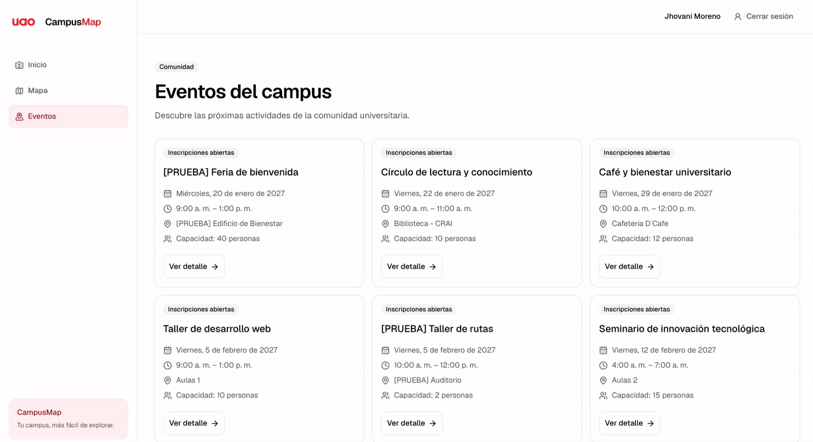

# CampusMap

## Universidad Autónoma de Occidente


**Asignatura:** Estructuras de Datos y Algoritmos  
**Integrantes:**  
- Laura Barbosa Torres - Cód. 2240395
- Jhovani Moreno Aguilar - Cód. 2238738
- Nicolás Romero Guarnizo - Cód. 2240393

**Docente:** Jonathan López Londoño  
**Fecha de entrega:** 18 de octubre de 2026


---

## 1. Resumen del proyecto

CampusMap es una aplicación web para consultar el mapa del campus de la Universidad Autónoma de Occidente (UAO), localizar puntos de interés, buscar ubicaciones y calcular recorridos peatonales entre un origen y un destino. Adicionalmente, contiene un módulo de eventos del campus, autenticación y registro de estudiantes a actividades.

El proyecto relaciona una aplicación interactiva con conceptos de estructuras de datos y algoritmos. En particular, el módulo de navegación modela el campus como un grafo ponderado y utiliza Dijkstra para encontrar una ruta de menor peso. El buscador utiliza un Trie y el historial de ubicaciones utiliza una pila. El módulo de eventos ordena los eventos mediante un Min-Heap.

El código distingue entre la información almacenada en Supabase y la geometría local versionada en `src/features/map/data/uao-network.json`. Supabase proporciona las filas públicas de ubicaciones y caminos; el archivo local aporta coordenadas, categorías, geometrías y procedencia de los caminos que se dibujan en Leaflet.

## 2. Planteamiento del problema

Un campus universitario contiene edificios, aulas, auditorios, servicios, porterías, zonas deportivas y otros puntos de interés. Para una persona que no conoce el campus, localizar un sitio o decidir por dónde caminar puede ser difícil, especialmente cuando existen caminos intermedios, conexiones de un solo sentido o zonas que no aparecen claramente en una lista textual.

CampusMap aborda este problema mediante una interfaz que combina:

- un mapa interactivo;
- búsqueda de lugares por prefijo;
- selección de origen y destino;
- cálculo de rutas con pesos asociados a los caminos;
- representación visual de los tramos de la ruta;
- consulta de eventos publicados del campus.

La solución no pretende calcular tiempos reales de caminata. La distancia mostrada corresponde a la suma de los pesos registrados en los caminos, y la animación de la ruta es únicamente una representación visual acelerada.

## 3. Objetivos

### Objetivo general

Desarrollar una aplicación web que facilite la consulta de ubicaciones y el cálculo de recorridos dentro del campus de la UAO, aplicando estructuras de datos y algoritmos a un problema de navegación representado como una red de conexiones.

### Objetivos específicos

1. Representar ubicaciones como vértices y caminos peatonales como aristas ponderadas de un grafo.
2. Construir una ruta de menor peso mediante el algoritmo de Dijkstra.
3. Implementar un buscador de ubicaciones basado en un Trie que normalice mayúsculas, tildes y espacios.
4. Mantener un historial de lugares consultados utilizando una pila LIFO.
5. Ordenar los eventos por fecha de inicio usando un Min-Heap.
6. Validar las estructuras y algoritmos mediante pruebas automatizadas de casos normales y casos límite.
7. Integrar la lógica algorítmica con una interfaz web desarrollada en React y TypeScript.

## 4. Descripción y funcionamiento

### 4.1 Flujo general



### 4.2 Mapa y carga de datos

La pantalla `/mapa` se implementa en `src/pages/MapPage.tsx`. Al cargarla, se consulta `fetchUaoNavigationNetwork()` en `src/services/locations.ts`. La consulta filtra ubicaciones públicas cuyo `slug` comienza por `uao-` y caminos públicos que conectan esas ubicaciones.

Después se realizan dos operaciones:

1. `attachNavigationGeometry()` valida que cada ubicación y camino recibido tenga una geometría compatible en `uao-network.json`.
2. `buildCampusGraph()` crea el grafo que utilizará el planificador de rutas.

El mapa se presenta mediante `CampusLeafletMap.tsx`, usando `react-leaflet` y Leaflet. Los puntos de interés se muestran como marcadores; los caminos se dibujan como polilíneas. Los caminos con procedencia `simulated` se representan discontinuos y se identifican como conexiones simuladas.

El archivo local contiene, según la validación ejecutada sobre el repositorio, 122 ubicaciones: 48 puntos de interés (`poi`) y 74 nodos técnicos (`node`). También contiene 116 caminos: 86 con procedencia `osm` y 30 simulados.

### 4.3 Búsqueda de ubicaciones

El panel de mapa contiene el campo **Explorar ubicaciones**. `LocationSearchIndex` indexa únicamente ubicaciones públicas de tipo `poi`. Para cada lugar guarda en un Trie una clave normalizada y conserva en un `Map` el ID y el objeto original.

La normalización:

- elimina tildes mediante normalización Unicode;
- convierte el texto a minúsculas;
- elimina espacios al inicio y al final;
- agrupa espacios consecutivos.

Cuando el usuario escribe un prefijo, el Trie devuelve hasta seis sugerencias. La lista conserva los nombres originales recibidos de Supabase. Si el campo está vacío, la interfaz muestra la lista de lugares en lugar de consultar sugerencias.

### 4.4 Selección de origen y destino

Los selectores de la pantalla permiten elegir un origen y un destino entre los puntos de interés públicos cargados. También se puede seleccionar un lugar desde la lista de búsqueda y utilizarlo como origen o como destino.

El botón **Intercambiar** cambia los valores de origen y destino. El botón **Calcular ruta** valida que ambos estén seleccionados y ejecuta `planCampusRoute()`.

Si alguna ubicación no pertenece al grafo o no hay conexión entre ambas, la interfaz muestra un mensaje y no dibuja una ruta. Un lugar puede ser consultable y visible aunque no tenga conexión peatonal disponible.

### 4.5 Cálculo y representación de rutas

`buildCampusGraph()` agrega todos los IDs de ubicaciones como vértices. Cada fila de `paths` se convierte en una dirección con el peso almacenado. Si `is_bidirectional` es verdadero, se agregan las dos direcciones; si es falso, se respeta únicamente la dirección registrada. Cuando hay dos filas con el mismo sentido, se conserva el menor peso.

`dijkstra()` calcula el menor costo desde el origen hasta el destino. El resultado contiene la secuencia de IDs, la distancia acumulada, los vértices visitados y un indicador `reachable`.

Después, `routeSegments()` relaciona cada par consecutivo de vértices con un camino que tenga geometría. Si la ruta usa el camino en sentido inverso y este es bidireccional, invierte sus coordenadas para que el dibujo continúe desde el origen hacia el destino.

La interfaz muestra:

- origen y destino;
- distancia aproximada en metros según los pesos del grafo;
- polilíneas de la ruta;
- indicación de conexiones simuladas;
- una animación opcional de recorrido.

### 4.6 Funcionalidades implementadas y pendientes

Están implementados el mapa, la búsqueda por prefijo, la selección de origen y destino, el cálculo de rutas, el historial de lugares consultados, la inversión de origen/destino, la representación de geometrías y la animación visual.

También están implementados el catálogo de eventos, el detalle de un evento, autenticación, registro de cuentas e inscripción/cancelación en eventos mediante funciones RPC de Supabase.

No se verificó una interfaz de administración para crear o editar ubicaciones, caminos o eventos. La gestión de esos datos está definida en la base de datos y sus políticas, pero no se presenta como una pantalla de administración dentro de las rutas de `src/App.tsx`. Tampoco se verificó un cálculo de tiempo real de caminata, navegación GPS o seguimiento de la posición del usuario.

## 5. Arquitectura y tecnologías

### 5.1 Tecnologías verificadas

| Tecnología | Uso en el proyecto |
|---|---|
| React 19 | Componentes y pantallas de la interfaz |
| TypeScript | Tipado estático y lógica de aplicación |
| Vite | Servidor de desarrollo y empaquetado |
| React Router | Rutas de inicio, mapa, eventos, login y registro |
| Leaflet | Renderizado del mapa y sus geometrías |
| React Leaflet | Integración de Leaflet con React |
| Tailwind CSS v4 | Estilos utilitarios |
| shadcn/ui y Base UI | Componentes visuales reutilizables |
| Lucide React | Iconos de la interfaz |
| Supabase | Autenticación, PostgreSQL, consultas y RPC |
| PostgreSQL | Persistencia, reglas de integridad, RLS e inscripciones |
| Vitest y Node Test | Pruebas declaradas o ejecutables según el archivo |

Las versiones declaradas se encuentran en `package.json`. Las dependencias instaladas en el entorno de revisión no permitieron ejecutar el binario `vitest`, por lo que esa limitación se reporta en la sección de pruebas.

### 5.2 Organización del código

```text
src/
├── algorithms/      Algoritmos generales, incluyendo Dijkstra
├── components/ui/   Componentes reutilizables de interfaz
├── features/        Módulos de mapa, autenticación y eventos
├── layouts/         Estructura compartida de la aplicación
├── pages/           Pantallas asociadas a las rutas
├── services/        Acceso a Supabase y operaciones de dominio
├── structures/      Graph, Trie, Stack, MinHeap y Queue
├── types/           Contratos de datos y estructuras
└── lib/             Cliente de Supabase y utilidades
```

Responsabilidades principales:

- `src/pages/`: compone la interacción de cada pantalla.
- `src/features/map/`: integra datos, búsqueda, geometría, planificación y animación.
- `src/structures/`: contiene las implementaciones manuales de las estructuras académicas.
- `src/algorithms/`: contiene Dijkstra separado de la interfaz.
- `src/services/`: realiza las consultas a Supabase y las llamadas a RPC.
- `supabase/migrations/`: define el esquema, restricciones, políticas RLS y funciones de base de datos.

### 5.3 Persistencia y seguridad

Las migraciones definen tablas para `profiles`, `locations`, `paths`, `events`, `event_registrations` y `event_waitlist`. Las tablas públicas tienen RLS habilitado. Las operaciones de inscripción y cancelación se realizan mediante RPC de PostgreSQL; el hook de React vuelve a consultar el servidor después de cada operación y no calcula localmente los cupos reales.

El frontend usa `VITE_SUPABASE_URL` y `VITE_SUPABASE_PUBLISHABLE_KEY`. No deben incluirse credenciales privadas en el archivo de entrega ni en el frontend.

## 6. Estructuras de datos implementadas

### 6.1 Grafo ponderado

**Concepto.** Un grafo está formado por vértices y aristas. En este proyecto cada ubicación es un vértice y cada camino es una arista con un peso numérico.

**Implementación.** `src/structures/Graph.ts` utiliza un `Map<T, Map<T, number>>` como lista de adyacencia. Permite agregar vértices, agregar o actualizar aristas, eliminar aristas y vértices, consultar vecinos y obtener los vértices.

**Justificación.** La lista de adyacencia es apropiada para una red de campus donde cada punto se conecta con un subconjunto de los demás puntos. Además, permite recorrer directamente los vecinos necesarios para Dijkstra.

**Uso real.** `buildCampusGraph()` crea el grafo en `src/features/map/lib/route-planner.ts`; `MapPage.tsx` lo conserva en el estado y lo entrega a `planCampusRoute()`.

**Ejemplo.** `Porteria 1`, un nodo peatonal y `Biblioteca - CRAI` son vértices relacionados por caminos cuyos pesos se suman para formar una ruta.

### 6.2 Trie

**Concepto.** Un Trie es un árbol de prefijos. Cada nivel representa un carácter y compartir prefijos evita repetir la misma secuencia de caracteres entre palabras relacionadas.

**Implementación.** `src/structures/Trie.ts` utiliza nodos con `Map<string, TrieNode>` y una marca `terminal`. Implementa inserción, búsqueda exacta, consulta de prefijo, sugerencias y eliminación.

**Justificación.** El problema del buscador es encontrar nombres que comienzan por el texto escrito. La estructura permite recorrer el prefijo y luego enumerar las palabras que continúan desde ese nodo.

**Uso real.** `LocationSearchIndex` en `src/features/map/lib/location-search.ts` indexa nombres de POI públicos y limita la interfaz a seis sugerencias.

**Ejemplo.** La consulta `bibli` puede sugerir `Biblioteca - CRAI` sin exigir que el usuario escriba el nombre completo ni que coincidan mayúsculas o tildes.

### 6.3 Pila enlazada

**Concepto.** Una pila sigue el principio LIFO: el último elemento insertado es el primero en salir.

**Implementación.** `src/structures/Stack.ts` usa nodos enlazados. `push`, `pop`, `peek`, `size`, `isEmpty` y `clear` mantienen el estado de la pila sin desplazar arreglos.

**Justificación.** El botón **Volver** debe regresar a la ubicación consultada inmediatamente antes. Una pila representa naturalmente ese historial hacia atrás.

**Uso real.** `LocationHistory` guarda los IDs anteriores en una `Stack<string>`. Cada visita apila el lugar actual antes de cambiar; `back()` extrae el anterior.

**Ejemplo.** Si el estudiante consulta `Biblioteca - CRAI`, luego `Auditorio LILE` y luego `Tienda UAO`, las operaciones de volver recuperan primero `Auditorio LILE` y después `Biblioteca - CRAI`.

### 6.4 Min-Heap

**Concepto.** En un Min-Heap, el elemento mínimo se mantiene en la raíz. Es común para obtener repetidamente el elemento con menor prioridad.

**Implementación.** `src/structures/MinHeap.ts` representa el árbol binario en un arreglo. Implementa `insert`, `peek`, `extract`, `size`, `isEmpty`, `clear` y `extractAll`, con desempate estable mediante un contador de inserción.

**Justificación.** Permite seleccionar el siguiente evento con fecha de inicio más temprana sin ordenar manualmente toda la estructura en cada extracción.

**Uso real.** `sortEventsByStart()` inserta los eventos recibidos desde Supabase y extrae todos en orden. `useUpcomingEvents()` aplica esa función antes de mostrar el catálogo.

**Ejemplo.** Si llegan eventos de noviembre, octubre y diciembre, el heap entrega primero el de octubre, después el de noviembre y finalmente el de diciembre. Si las fechas empatan, `compareByStart()` desempata por ID.

### 6.5 Cola FIFO

**Concepto.** Una cola sigue el principio FIFO: el primero en entrar es el primero en salir.

**Implementación.** `src/structures/Queue.ts` usa un arreglo y un índice `head`. `enqueue()` agrega al final y `dequeue()` avanza el índice, evitando `Array.shift()`.

**Estado de integración.** La clase está implementada y tiene pruebas, pero no se encontró una importación de `Queue` en el flujo actual de `src`. Los cupos y la lista de espera de eventos se gestionan en PostgreSQL mediante `register_for_event`, `cancel_event_registration` y las funciones relacionadas. Por tanto, la cola debe documentarse como estructura implementada y validada, no como mecanismo que actualmente asigna cupos en la aplicación.

**Ejemplo académico.** Una cola podría representar estudiantes esperando un cupo, pero en la versión actual ese orden FIFO se materializa en la tabla `event_waitlist`, ordenada por `joined_at, id`, dentro de PostgreSQL.

## 7. Algoritmos implementados

### 7.1 Dijkstra

**Propósito.** Encontrar una ruta de menor suma de pesos entre un origen y un destino en un grafo con pesos no negativos.

**Funcionamiento en CampusMap.**

1. Se verifica que origen y destino existan como vértices.
2. Se inicializan todas las distancias en infinito y la distancia del origen en cero.
3. Se selecciona, mediante una búsqueda lineal, el vértice no fijado con menor distancia conocida.
4. Se marca el vértice como visitado.
5. Se revisan sus vecinos y se relajan las aristas: si pasar por el vértice actual mejora una distancia, se actualizan la distancia y el predecesor.
6. Se detiene al fijar el destino o cuando no queda un vértice alcanzable.
7. Se reconstruye el camino siguiendo el mapa `previous` desde el destino hasta el origen.

**Archivo.** `src/algorithms/dijkstra.ts`.

**Estructuras utilizadas.** `Map` para distancias y predecesores, `Set` para vértices fijados y el contrato de `Graph` para acceder a vecinos.

**Complejidad.** La selección lineal del siguiente vértice se repite hasta `V` veces y revisa `V` vértices cada vez. Las relajaciones suman `E`, por lo que la complejidad temporal de esta implementación es `O(V² + E)`. El espacio adicional es `O(V)` para distancias, predecesores, conjunto de fijados y lista de visitados, sin contar el grafo.

**Restricción.** Rechaza pesos no finitos o negativos. La base de datos también exige pesos no negativos.

### 7.2 Construcción del grafo y relajación de direcciones

`buildCampusGraph()` recorre las ubicaciones para crear vértices y luego recorre los caminos para generar direcciones. Respeta `is_bidirectional` y deduplica caminos del mismo sentido conservando el peso menor. Su costo es `O(V + E)` esperado usando `Map`, sin contar posibles validaciones externas.

Esto es importante porque Dijkstra no recibe directamente filas de Supabase: recibe un grafo consistente, con los sentidos y pesos ya interpretados.

### 7.3 Recuperación de geometrías de la ruta

`routeSegments()` recorre los pares consecutivos del resultado de Dijkstra, busca un camino compatible y orienta sus coordenadas según el sentido de recorrido. Verifica que los extremos geométricos coincidan con las coordenadas de las ubicaciones.

La implementación filtra `network.paths` para cada tramo de la ruta; en el peor caso, si `K` es el número de tramos, su búsqueda puede costar `O(K·E)`. La generación de la salida consume `O(K)` segmentos, además de las coordenadas copiadas.

### 7.4 Sugerencias con Trie

La inserción y la búsqueda de una palabra de longitud `L` recorren sus caracteres y tienen costo `O(L)` esperado con los mapas de hijos. Para sugerencias, el algoritmo llega al nodo del prefijo y realiza un recorrido de las ramas descendientes, ordenando las claves de cada nodo para dar un resultado determinista. Si `S` es el número de caracteres visitados en el subárbol y `K` el límite de resultados, el costo se puede expresar como `O(L + S)` en el peor caso, con espacio proporcional a los caracteres almacenados.

### 7.5 Operaciones de pila e historial

`Stack.push`, `pop` y `peek` son `O(1)`. `LocationHistory` usa estas operaciones para consultar hacia atrás sin alterar el historial de forma incorrecta: volver extrae una entrada y no vuelve a apilar la ubicación actual.

### 7.6 Ordenamiento de eventos con Min-Heap

Para `n` eventos, `sortEventsByStart()` inserta cada uno en el heap y luego extrae todos. Cada inserción y extracción cuesta `O(log n)`, por lo que el costo total es `O(n log n)` y el espacio del heap es `O(n)`. El comparador usa la fecha ISO `starts_at` y, en caso de empate, el ID.

### 7.7 Animación de la ruta

`buildAnimationTrack()` une las coordenadas de los segmentos consecutivos, evita duplicar el punto de unión y acumula distancias geográficas mediante la fórmula de Haversine. `positionAtProgress()` busca el tramo que contiene el progreso solicitado e interpola linealmente entre sus extremos.

La animación es visual y acelerada. El código declara expresamente que no representa el tiempo real de caminata. Para una pista con `P` puntos, la búsqueda de una posición es `O(P)` porque recorre los puntos desde el inicio.

## 8. Relación entre teoría y aplicación

| Estructura o algoritmo | Concepto académico | Aplicación en CampusMap | Estado |
|---|---|---|---|
| `Graph<T>` | Grafo ponderado y lista de adyacencia | Representa ubicaciones y caminos peatonales | Implementado y usado |
| Dijkstra | Camino mínimo con pesos no negativos | Calcula la ruta entre origen y destino | Implementado y usado |
| Trie | Árbol de prefijos | Sugerencias del buscador de ubicaciones | Implementado y usado |
| Stack | LIFO | Historial y botón Volver del mapa | Implementado y usado |
| Min-Heap | Cola de prioridad mínima | Orden de eventos por fecha de inicio | Implementado y usado |
| Queue | FIFO | Estructura disponible para demostración; no asigna cupos actualmente | Implementado y probado, no integrado al flujo actual |
| `Map` y `Set` | Asociaciones y pertenencia eficiente | Índices, distancias, vértices visitados y lugares por ID | Usados en varios módulos |
| Haversine/interpolación | Distancia geográfica y posición intermedia | Animación visual de la ruta | Implementado y usado |

## 9. Ejemplo de funcionamiento verificable

Se puede tomar como escenario `Porteria 1` como origen y `Biblioteca - CRAI` como destino. Este ejemplo utiliza únicamente nombres y conexiones presentes en `src/features/map/data/uao-network.json`.

La ejecución verificada construye un grafo con 122 ubicaciones y 116 caminos. Dijkstra devuelve la siguiente secuencia:

```text
Porteria 1
→ Nodo peatonal -76.5231689,3.3536522
→ Nodo peatonal -76.5227300,3.3536565
→ Nodo peatonal -76.5227293,3.3535027
→ Nodo peatonal -76.5222391,3.3535055
→ Biblioteca - CRAI
```

El resultado verificado tiene:

- distancia acumulada: `156.572` según los pesos de los caminos;
- 5 tramos;
- 18 vértices visitados por Dijkstra antes de determinar la ruta;
- 2 conexiones simuladas y 3 conexiones con procedencia `osm` en los segmentos seleccionados.

El primer tramo comienza en `Porteria 1`, los tres tramos intermedios corresponden a nodos y caminos de la red, y el último tramo llega a `Biblioteca - CRAI`. `routeSegments()` valida que las coordenadas de cada segmento comiencen y terminen en las ubicaciones esperadas. Luego `CampusLeafletMap` dibuja la ruta como polilíneas y puede animarla.

La distancia no se interpreta como una medición GPS ni como una estimación del tiempo de desplazamiento: es la suma de los pesos de las filas de caminos seleccionadas.

### Evidencia visual de funcionamiento

Las siguientes demostraciones GIF muestran la interacción con el mapa y el cálculo/animación de recorridos dentro de CampusMap:





## 10. Instrucciones de ejecución

### Requisitos

El `README.md` del proyecto indica:

- Node.js 20 o superior;
- pnpm;
- Docker Engine y Docker Compose para Supabase local;
- Supabase CLI como dependencia del proyecto.

### Instalación

Desde la raíz:

```bash
pnpm install
```

El `package.json` ya declara `supabase` y `vitest` como dependencias de desarrollo. El README también documenta `pnpm add -D supabase` para proyectos donde todavía no se haya instalado la CLI y `pnpm supabase init` para inicializar la carpeta local de Supabase si aún no existe.

### Variables de entorno

Crear `.env.local` o el archivo de entorno que utilice el equipo, sin subirlo al repositorio, con las variables públicas:

```env
VITE_SUPABASE_URL=...
VITE_SUPABASE_PUBLISHABLE_KEY=...
```

No incluir claves secretas ni credenciales privadas en la aplicación frontend ni en este documento. La configuración de Vite expone las variables con prefijo `VITE_` al navegador.

### Supabase local

Con Docker iniciado:

```bash
pnpm supabase start
pnpm supabase db reset
pnpm supabase status
```

`db reset` aplica las migraciones y las semillas locales. La semilla `supabase/seed.sql` contiene datos ficticios de prueba; la red UAO está en `supabase/seeds/uao_navigation.sql` y su geometría versionada en `src/features/map/data/uao-network.json`.

### Frontend

```bash
pnpm dev
```

La aplicación se sirve normalmente en `http://localhost:5173`.

### Comandos de validación declarados

```bash
pnpm lint
pnpm build
pnpm test
```

La entrega debe conservar la observación de la sección anterior: en el entorno utilizado para esta documentación, `pnpm test` y `pnpm build` requieren que se complete correctamente la instalación de las dependencias y tipos de Vitest.

## 11. Estado actual del proyecto

### 11.1 Implementadas

- Navegación entre inicio, mapa, eventos, detalle, login y registro.
- Carga de ubicaciones y caminos públicos desde Supabase.
- Validación y asociación con geometría local de navegación.
- Mapa Leaflet con marcadores, polilíneas, tooltips y popups.
- Búsqueda de POI mediante Trie, con normalización de texto y límite de seis sugerencias.
- Historial de lugares consultados mediante Stack y botón Volver.
- Grafo ponderado en memoria.
- Cálculo de rutas con Dijkstra.
- Respeto de conexiones bidireccionales y unidireccionales.
- Validación de pesos, vértices, geometrías y rutas inalcanzables.
- Distancia acumulada y señalización de conexiones simuladas.
- Animación visual de la geometría de la ruta.
- Catálogo de eventos futuros ordenado con Min-Heap.
- Detalle de eventos y ubicación relacionada.
- Registro, login, logout y redirecciones internas seguras.
- Inscripción, cancelación, disponibilidad y estado propio mediante RPC de Supabase.
- Migraciones, restricciones, RLS y pruebas SQL de seguridad presentes en el repositorio.

### 11.2 Parcialmente implementadas o condicionadas al entorno

- La funcionalidad de mapa depende de que Supabase tenga cargada la red UAO y de que las variables de entorno sean correctas.
- La geometría local y las filas de Supabase deben mantenerse sincronizadas; si falta una geometría, la carga del mapa muestra un error.
- La cola FIFO está implementada, pero no es la estructura que gestiona actualmente la lista de espera de eventos; esa operación está en PostgreSQL.
- Las pruebas TypeScript existen, pero no se pudieron ejecutar con `pnpm test` en el entorno revisado porque faltaba el ejecutable `vitest`.
- El build no pudo completarse en el entorno revisado por la ausencia de tipos del módulo `vitest`.

### 11.3 Pendientes o no verificadas en el código

- No se verificó una pantalla de administración para gestionar ubicaciones, caminos o eventos.
- No se verificó navegación GPS, ubicación en tiempo real ni recalculo dinámico según la posición del estudiante.
- No se verificó un cálculo de duración real de caminata; la animación es demostrativa.
- No se verificó una búsqueda por texto libre en descripciones o categorías: el índice implementado usa nombres de POI.
- No se verificó una integración de `Queue` con la interfaz de inscripciones.

## 12. Conclusiones

CampusMap muestra cómo un problema cotidiano de orientación dentro de un campus puede modelarse con conceptos fundamentales de estructuras de datos y algoritmos. El grafo permite representar los caminos, mientras que Dijkstra encuentra una ruta de menor costo cuando los pesos son no negativos. La lista de adyacencia evita representar conexiones inexistentes y facilita consultar los vecinos de cada ubicación.

El Trie demuestra la utilidad de una estructura especializada para búsquedas por prefijo. La pila simplifica el historial de navegación y el Min-Heap organiza eficientemente los eventos por prioridad temporal. La cola está disponible como implementación académica y sus pruebas validan su comportamiento FIFO, aunque la lógica real de cupos se delega a PostgreSQL por razones de consistencia y concurrencia.

El proyecto también evidencia que la complejidad algorítmica debe analizarse junto con la arquitectura. Dijkstra usa una selección lineal y tiene costo `O(V² + E)`, una decisión explícita del código que resulta suficiente para la red actual. La aplicación separa la lógica de estructuras y algoritmos de los componentes visuales, lo que facilita probarlos sin depender del navegador.

## 13. Referencias técnicas

### Archivos relevantes del repositorio

- [README.md](README.md)
- [Arquitectura](docs/architecture.md)
- [Contratos de estructuras](docs/data-structures.md)
- [Base de datos](docs/database.md)
- [Flujo de desarrollo](docs/development.md)
- [Entrada de la aplicación](src/App.tsx)
- [Pantalla del mapa](src/pages/MapPage.tsx)
- [Componente Leaflet](src/features/map/components/CampusLeafletMap.tsx)
- [Planificador de rutas](src/features/map/lib/route-planner.ts)
- [Geometría de navegación](src/features/map/lib/navigation-geometry.ts)
- [Buscador de ubicaciones](src/features/map/lib/location-search.ts)
- [Historial de ubicaciones](src/features/map/lib/location-history.ts)
- [Animación de rutas](src/features/map/lib/route-animation.ts)
- [Dijkstra](src/algorithms/dijkstra.ts)
- [Grafo](src/structures/Graph.ts)
- [Trie](src/structures/Trie.ts)
- [Pila](src/structures/Stack.ts)
- [Min-Heap](src/structures/MinHeap.ts)
- [Cola](src/structures/Queue.ts)
- [Ordenamiento de eventos](src/features/events/sortEvents.ts)
- [Datos geográficos versionados](src/features/map/data/uao-network.json)
- [Migración inicial](supabase/migrations/20261011000000_initial_schema.sql)
- [Pruebas automatizadas](tests/)

### Referencias externas pertinentes

- [React](https://react.dev/)
- [TypeScript](https://www.typescriptlang.org/docs/)
- [Vite](https://vite.dev/guide/)
- [React Router](https://reactrouter.com/)
- [Leaflet](https://leafletjs.com/reference.html)
- [React Leaflet](https://react-leaflet.js.org/)
- [Supabase](https://supabase.com/docs)
- [Documentación de Unicode Normalization](https://developer.mozilla.org/en-US/docs/Web/JavaScript/Reference/Global_Objects/String/normalize)

## Nota de verificación

Este documento se elaboró a partir del código, datos, migraciones, pruebas y configuración presentes en el repositorio. No se agregaron resultados de funcionalidades que no pudieran comprobarse directamente. Los comandos de prueba y build se reportan con el resultado observado en el entorno de revisión.
