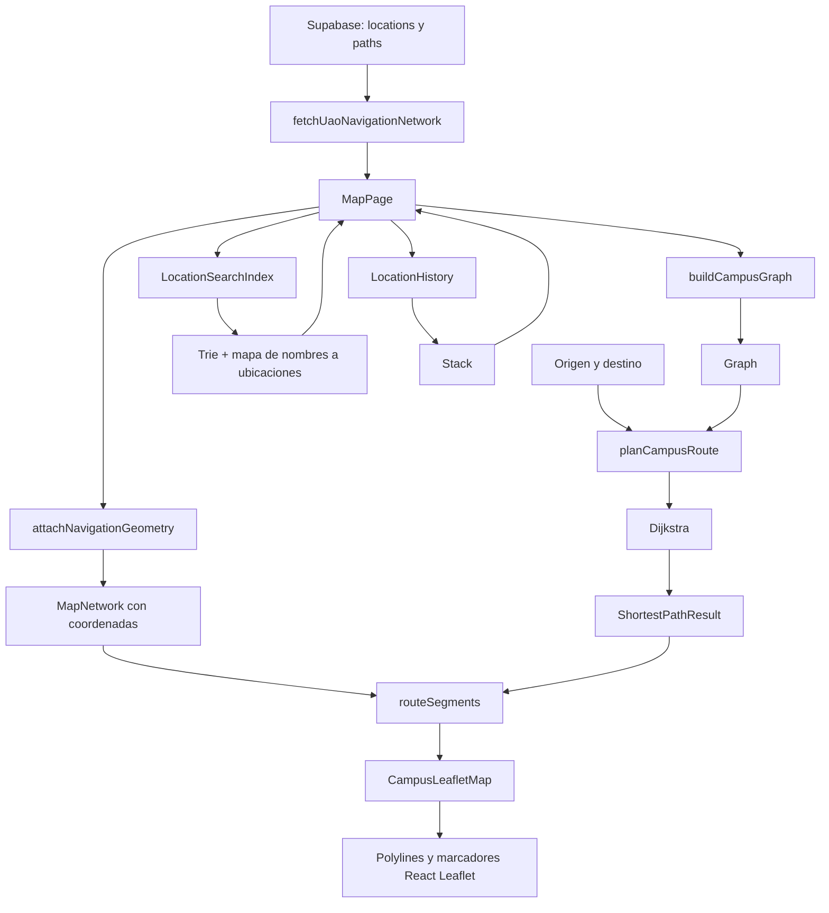

# Guía de desarrollo 1:

## CampusMap: navegación, mapas, rutas y búsqueda

> Esta guía describe la implementación que existe actualmente en el repositorio. Los ejemplos, nombres de funciones, archivos, cantidades y resultados de pruebas se basan en el código versionado de CampusMap.

## 1. Introducción

CampusMap es una aplicación web para explorar el campus de la Universidad Autónoma de Occidente. El proyecto integra un mapa, ubicaciones de interés, eventos y autenticación. El módulo de navegación permite consultar lugares del campus, buscar un lugar por nombre, seleccionar un origen y un destino y calcular una ruta de menor distancia entre ambos.

El problema concreto que resuelve este módulo es convertir una red de ubicaciones y caminos en una ruta que una persona pueda entender visualmente. La base de datos contiene ubicaciones y conexiones; el frontend transforma esos registros en un grafo, ejecuta Dijkstra y luego dibuja los tramos correspondientes sobre un mapa de Leaflet.

Actividades realizadas:

- Construir el grafo ponderado de navegación.
- Implementar y conectar Dijkstra con el mapa.
- Implementar la búsqueda por prefijo usando un Trie.
- Implementar el historial de lugares consultados usando una pila.
- Integrar las estructuras con React, Supabase y React Leaflet.
- Validar las rutas, la geometría geográfica y los casos de ubicaciones aisladas.
- Escribir pruebas independientes de la interfaz para las estructuras, la navegación y la animación.

Los archivos principales del módulo son:

| Responsabilidad | Archivo |
| --- | --- |
| Grafo | `src/structures/Graph.ts` |
| Dijkstra | `src/algorithms/dijkstra.ts` |
| Trie | `src/structures/Trie.ts` |
| Pila | `src/structures/Stack.ts` |
| Adaptación de datos a grafo | `src/features/map/lib/route-planner.ts` |
| Búsqueda de ubicaciones | `src/features/map/lib/location-search.ts` |
| Historial | `src/features/map/lib/location-history.ts` |
| Consulta a Supabase | `src/services/locations.ts` |
| Geometría geográfica | `src/features/map/lib/navigation-geometry.ts` |
| Página del mapa | `src/pages/MapPage.tsx` |
| Representación visual | `src/features/map/components/CampusLeafletMap.tsx` |

## 2. Arquitectura del módulo

### 2.1. Entrada de datos

La página `MapPage` carga de forma diferida el servicio `src/services/locations.ts`. La función usada para la navegación es `fetchUaoNavigationNetwork()`.

Esta función realiza dos consultas públicas:

```ts
const { data: locations } = await supabase
  .from('locations')
  .select('*')
  .eq('is_public', true)
  .like('slug', 'uao-%')
  .order('name')
```

Después obtiene los caminos cuyos extremos pertenecen a las ubicaciones UAO recuperadas. El filtro `slug like 'uao-%'` evita mezclar los registros ficticios de la semilla local, cuyos slugs empiezan por `prueba-`.

### 2.2. Adaptación de la red

En `MapPage.tsx`, después de consultar Supabase, se ejecutan dos transformaciones:

```ts
const mapped = attachNavigationGeometry(rows.locations, rows.paths)
const loadedGraph = buildCampusGraph(rows.locations, rows.paths)
```

La primera combina los registros de PostgreSQL con el archivo versionado `src/features/map/data/uao-network.json`. PostgreSQL decide qué filas públicas existen y qué pesos tienen; el JSON aporta las coordenadas `[lat, lng]`, la categoría, el tipo de ubicación y la geometría de cada camino.

La segunda transformación crea un `Graph<string>` en memoria. Cada ubicación se convierte en un vértice y cada fila de `paths` se convierte en una o dos direcciones del grafo, según `is_bidirectional`.

### 2.3. Integración con React

La página mantiene en estado de React:

- `network`: ubicaciones y caminos con geometría.
- `graph`: grafo preparado para Dijkstra.
- `originId` y `destinationId`: IDs elegidos en los selectores.
- `route`: resultado de la ruta planificada.
- `query`: texto escrito en el buscador.
- `history`: instancia de `LocationHistory`.

El buscador crea un `LocationSearchIndex` a partir de la red. El índice usa un Trie internamente, pero conserva un mapa de claves normalizadas a objetos completos `MapLocation` para devolver el ID, nombre y coordenadas originales.

### 2.4. Flujo de información



### 2.5. Separación entre cálculo y dibujo

El algoritmo no dibuja directamente. Dijkstra devuelve IDs y distancia. `routeSegments()` traduce cada par consecutivo de IDs a un camino con coordenadas. Finalmente `CampusLeafletMap` usa `Polyline` para dibujar.

Esta separación es importante porque permite probar el grafo y Dijkstra sin montar React ni Leaflet.

## 3. Grafo (`Graph`)

### 3.1. Concepto

Un grafo está compuesto por vértices y aristas:

- Un vértice representa una ubicación del campus.
- Una arista representa una conexión entre dos ubicaciones.
- El peso representa la distancia aproximada del tramo, en metros.

En el proyecto los vértices usan IDs `string`, normalmente UUID de Supabase. La clase es genérica (`Graph<T>`), por lo que técnicamente podría almacenar otros tipos de identificadores.

### 3.2. Representación interna

`Graph.ts` utiliza una lista de adyacencia basada en mapas:

```ts
private readonly adjacency = new Map<T, Map<T, number>>()
```

Conceptualmente, una red pequeña podría verse así:

```text
A ── 12 m ──> B ── 8 m ──> C
│
└── 30 m ──> C
```

Internamente sería equivalente a:

```text
adjacency[A] = { B: 12, C: 30 }
adjacency[B] = { C: 8 }
adjacency[C] = { }
```

Una lista de adyacencia es adecuada para navegación porque permite obtener directamente los vecinos de la ubicación actual sin recorrer todas las posibles aristas.

### 3.3. Ponderado, dirigido y bidireccional

El grafo es ponderado porque cada conexión tiene un número `weight`.

En `Graph.addEdge(from, to, weight, bidirectional = true)`, una arista es bidireccional por defecto. En ese caso se guardan las dos direcciones:

```ts
this.adjacency.get(from)!.set(to, weight)
if (bidirectional) this.adjacency.get(to)!.set(from, weight)
```

Si `bidirectional` es `false`, solo se crea `from → to`. Por eso la estructura soporta tanto caminos bidireccionales como caminos dirigidos.

En la red actual los caminos del campus se cargan respetando `is_bidirectional`. En `buildCampusGraph`, primero se agregan las direcciones necesarias y después se insertan en `Graph` con `bidirectional = false`, porque el adaptador ya decidió explícitamente cuáles sentidos existen.

### 3.4. Métodos implementados

#### `addVertex(vertex)`

Agrega un vértice si todavía no existe. Si se llama dos veces con el mismo vértice, no lo duplica.

```ts
if (!this.adjacency.has(vertex)) this.adjacency.set(vertex, new Map())
```

#### `addEdge(from, to, weight, bidirectional)`

Valida que el peso sea finito y no negativo, crea los vértices ausentes y agrega la conexión. La validación es necesaria porque Dijkstra requiere pesos no negativos.

#### `removeEdge(from, to, bidirectional)`

Elimina una dirección o ambas. Devuelve `true` si eliminó alguna conexión y `false` si no encontró la arista.

#### `removeVertex(vertex)`

Elimina el vértice y luego recorre las listas de adyacencia para borrar las referencias que apuntaban a él. Esto evita dejar aristas colgantes.

#### `getNeighbors(vertex)`

Devuelve los vecinos y sus pesos. La implementación devuelve un arreglo nuevo:

```ts
return neighbors ? Array.from(neighbors, ([to, weight]) => ({ to, weight })) : []
```

Por eso el consumidor no puede cambiar accidentalmente el grafo modificando el resultado.

#### `hasVertex(vertex)` y `vertices()`

Permiten validar la existencia de un vértice y obtener todos los vértices del grafo.

### 3.5. Construcción del grafo del campus

`buildCampusGraph` realiza estas validaciones:

1. Agrega todas las ubicaciones como vértices.
2. Rechaza un camino cuyo origen o destino no exista.
3. Rechaza pesos no finitos o negativos.
4. Agrega la dirección de origen a destino.
5. Agrega la dirección inversa si `is_bidirectional` es verdadero.
6. Si existen dos filas con el mismo sentido, conserva el menor peso.

La deduplicación se hace antes de insertar las aristas:

```ts
const previous = neighbors.get(to)
if (previous === undefined || weight < previous) neighbors.set(to, weight)
```

### 3.6. Complejidad del grafo

Sea `V` el número de vértices y `E` el número de aristas almacenadas, contando cada dirección como una entrada.

| Operación | Complejidad temporal esperada | Espacio adicional |
| --- | ---: | ---: |
| `addVertex` | `O(1)` | `O(1)` |
| `addEdge` | `O(1)` | `O(1)` |
| `hasVertex` | `O(1)` | `O(1)` |
| `getNeighbors(v)` | `O(grado(v))` | `O(grado(v))` por la copia |
| `vertices` | `O(V)` | `O(V)` por el arreglo devuelto |
| `removeEdge` | `O(1)` | `O(1)` |
| `removeVertex` | `O(V)` | `O(1)` adicional |

La memoria total del grafo es `O(V + E)`. En un camino bidireccional se almacenan dos entradas, una por sentido.

## 4. Algoritmo Dijkstra

### 4.1. Problema que resuelve

Dijkstra encuentra la ruta de menor suma de pesos desde un origen hasta un destino en un grafo con pesos no negativos.

En CampusMap, la suma de pesos representa la distancia aproximada recorrida por los senderos. El algoritmo no calcula rutas geográficas por sí mismo ni conoce mapas; solo trabaja con vértices, vecinos y pesos.

### 4.2. Estructuras utilizadas

La función `dijkstra` usa:

- `distances`: mejor distancia conocida hacia cada vértice.
- `previous`: predecesor de cada vértice en la mejor ruta conocida.
- `settled`: vértices cuya distancia mínima ya fue confirmada.
- `visited`: orden en que se confirmaron vértices; se devuelve para observación y pruebas.

Fragmento real de `src/algorithms/dijkstra.ts`:

```ts
const distances = new Map<T, number>(vertices.map((vertex) => [vertex, Infinity]))
const previous = new Map<T, T>()
const settled = new Set<T>()
const visited: T[] = []
distances.set(source, 0)
```

### 4.3. Funcionamiento paso a paso

1. Si el origen o el destino no existe, devuelve una respuesta inalcanzable.
2. Inicializa todas las distancias en infinito.
3. Define la distancia del origen como cero.
4. Busca entre todos los vértices no confirmados el que tenga menor distancia conocida.
5. Marca ese vértice como confirmado.
6. Si es el destino, termina temprano.
7. Recorre sus vecinos y calcula una posible nueva distancia:

```ts
const candidate = best + edge.weight
```

8. Si la nueva distancia es menor, actualiza `distances` y guarda el vértice actual en `previous`.
9. Cuando termina, reconstruye la ruta desde el destino hacia el origen usando `previous` y la inserta al principio del arreglo.

La selección del vértice mínimo se implementa recorriendo todos los vértices:

```ts
for (const vertex of vertices) {
  const distance = distances.get(vertex) ?? Infinity
  if (!settled.has(vertex) && distance < best) {
    current = vertex
    found = true
    best = distance
  }
}
```

Por eso esta versión no usa un heap de prioridad.

### 4.4. Resultado y caso sin ruta

El tipo `ShortestPathResult` contiene:

```ts
{
  path: TNodeId[]
  distance: number
  visited_nodes: TNodeId[]
  reachable: boolean
}
```

Si no existe ruta, devuelve:

```ts
{ path: [], distance: Infinity, visited_nodes, reachable: false }
```

En `MapPage`, ese resultado se transforma en un mensaje como “No existe un recorrido entre las ubicaciones seleccionadas” o “Una de las ubicaciones no tiene conexión peatonal disponible”.

Esto sucede, por ejemplo, con ubicaciones visibles que no tienen conexión peatonal en el conjunto de datos. No se dibuja una línea inventada para unirlas.

### 4.5. Ejemplo real de la UAO

El repositorio contiene 122 ubicaciones: 48 puntos de interés y 74 nodos técnicos. También contiene 116 conexiones: 86 tramos OSM y 30 conexiones simuladas. Las pruebas de `route-planner.test.mjs` comprueban esas cantidades.

Al construir el grafo con `src/features/map/data/uao-network.json`, la ruta:

```text
Porteria 1 → Biblioteca - CRAI
```

produce una distancia aproximada de:

```text
156.572 metros
```

La ruta pasa por cuatro nodos peatonales intermedios y cinco segmentos. La secuencia conceptual es:

```text
Porteria 1
  → nodo peatonal cercano a Porteria 1
  → nodos del sendero OSM
  → nodo cercano a Biblioteca - CRAI
  → Biblioteca - CRAI
```

El valor no es una estimación de tiempo. Los pesos se generaron con distancia Haversine y las conexiones simuladas se identifican aparte en los datos.

Otro caso probado es `Aulas 1 → Parqueadero de Bicicletas`. El resultado es `reachable: false`, porque el parqueadero permanece visible como POI, pero aislado de la red navegable actual.

### 4.6. Complejidad de la implementación

El comentario de la implementación indica `O(V² + E)`. La razón es:

- Hay hasta `V` iteraciones principales.
- En cada iteración se recorren todos los vértices para encontrar el menor: `O(V)`.
- En conjunto, la selección cuesta `O(V²)`.
- Las relajaciones recorren las aristas: `O(E)`.

Por tanto:

```text
Tiempo: O(V² + E)
Espacio: O(V + E) contando el grafo; O(V) adicional para Dijkstra
```

Una versión con heap podría reducir la selección del mínimo, pero el repositorio implementa deliberadamente Dijkstra sin heap porque el objetivo actual es un mapa MVP y la implementación debe ser comprensible y propia.

## 5. Trie y búsqueda por prefijo

### 5.1. Qué es un Trie

Un Trie es un árbol en el que cada camino desde la raíz representa una secuencia de caracteres. Las palabras que comparten prefijo comparten nodos.

Por ejemplo, estas ubicaciones comparten el prefijo `biblioteca`:

```text
raíz
 └── b ─ i ─ b ─ l ─ i ─ o ─ t ─ e ─ c ─ a
       ├── terminal: Biblioteca
       ├── ... centro
       ├── ... norte
       └── ... sur
```

En `src/structures/Trie.ts`, cada nodo tiene:

```ts
interface TrieNode {
  children: Map<string, TrieNode>
  terminal: boolean
}
```

`terminal` indica que allí termina una palabra completa. Esto permite distinguir `aula` de `aulas`.

### 5.2. Normalización de nombres

La función `normalizeTrieText` convierte el texto a una forma común:

```ts
return value.normalize('NFD')
  .replace(/\p{M}/gu, '')
  .toLowerCase()
  .trim()
  .replace(/\s+/g, ' ')
```

Esto significa que:

- `BÍBLIOTECA CRAI` se convierte en `biblioteca crai`.
- Se eliminan las tildes mediante descomposición Unicode.
- Se ignoran diferencias entre mayúsculas y minúsculas.
- Se eliminan espacios al inicio y al final.
- Varias separaciones se convierten en un solo espacio.

El texto normalizado se usa tanto al insertar como al buscar, por lo que ambas operaciones son consistentes.

### 5.3. Operaciones del Trie

#### `insert(word)`

Recorre o crea un nodo por cada carácter normalizado y marca el último nodo como terminal. Las inserciones vacías se ignoran.

#### `search(word)`

Busca la secuencia completa y exige que el último nodo sea terminal. Por eso `search('bibli')` no afirma que `bibli` sea un nombre completo aunque exista el prefijo.

#### `startsWith(prefix)`

Comprueba si existe un camino de nodos para el prefijo. No exige que el nodo sea terminal.

#### `suggestions(prefix, limit)`

Primero llega al nodo del prefijo y después recorre su subárbol en orden alfabético determinista. Devuelve palabras completas hasta el límite solicitado.

#### `remove(word)`

Desmarca la palabra completa y elimina nodos que ya no pertenecen a otra palabra. Si una rama todavía es compartida, se conserva.

### 5.4. Integración con `LocationSearchIndex`

El índice de ubicaciones no inserta todos los nodos técnicos. Solo incluye ubicaciones públicas cuyo `kind` es `poi`:

```ts
if (!location.is_public || location.kind !== 'poi') continue
```

El Trie guarda la clave normalizada. El índice paralelo `placesByKey` conserva los objetos originales:

```ts
private readonly placesByKey = new Map<string, Map<string, MapLocation>>()
```

Así se puede buscar con texto normalizado, pero devolver el nombre original, su ID y sus coordenadas.

Cuando el estudiante escribe, `MapPage` llama a `searchIndex.suggest(query)`. El límite real de la interfaz es seis sugerencias (`MAX_LOCATION_SUGGESTIONS = 6`).

### 5.5. Complejidad del Trie

Sea `L` la longitud de la palabra o prefijo y `S` el número de nodos que se visitan al generar sugerencias:

| Operación | Complejidad |
| --- | ---: |
| Normalización | `O(L)` |
| `insert` | `O(L)` esperado |
| `search` | `O(L)` esperado |
| `startsWith` | `O(L)` esperado |
| `remove` | `O(L)` esperado |
| `suggestions` | `O(L + S)` en el peor caso de recorrido |

Los accesos a `Map` se consideran de tiempo esperado constante. El espacio es `O(C)`, donde `C` es el total de caracteres almacenados en los prefijos no compartidos. Las palabras con prefijos comunes reutilizan nodos.

## 6. Stack o pila

### 6.1. LIFO

Una pila sigue el principio LIFO: “Last In, First Out”, es decir, el último elemento agregado es el primero que sale.

La implementación usa nodos enlazados:

```ts
interface StackNode<T> {
  value: T
  next: StackNode<T> | undefined
}
```

La pila solo necesita conocer el nodo superior (`top`).

### 6.2. Operaciones

- `push(value)`: inserta un nodo en la parte superior.
- `pop()`: retira y devuelve el nodo superior.
- `peek()`: consulta el superior sin retirarlo.
- `size()`: devuelve la cantidad de elementos.
- `isEmpty()`: indica si no hay elementos.
- `clear()`: descarta la referencia al nodo superior y reinicia el tamaño.

El `push` real es:

```ts
this.top = { value, next: this.top }
this.length += 1
```

### 6.3. Uso en el historial

`LocationHistory` mantiene:

```ts
private readonly previous = new Stack<string>()
private currentId: string | undefined
```

Cuando se visita una ubicación nueva, la ubicación actual se guarda en la pila antes de cambiar el estado:

```ts
if (this.currentId !== undefined) this.previous.push(this.currentId)
this.currentId = id
```

Cuando se pulsa **Volver**, se hace `pop()` y ese ID se convierte en el actual.

Ejemplo:

```text
visit(Biblioteca)
  actual = Biblioteca
  pila = []

visit(Cafetería)
  actual = Cafetería
  pila = [Biblioteca]

visit(Edificio Central)
  actual = Edificio Central
  pila = [Biblioteca, Cafetería]

back()
  devuelve Cafetería
  actual = Cafetería
  pila = [Biblioteca]

back()
  devuelve Biblioteca
  actual = Biblioteca
  pila = []
```

Visitar repetidamente el mismo ID no crea una entrada duplicada: `visit` devuelve `false` si el ID coincide con `currentId`.

### 6.4. Complejidad de la pila

Todas las operaciones principales de `Stack` son `O(1)`:

```text
push: O(1)
pop: O(1)
peek: O(1)
size: O(1)
isEmpty: O(1)
clear: O(1)
```

El espacio es `O(H)`, donde `H` es el número de lugares guardados en el historial.

## 7. Integración visual

### 7.1. Selección de origen y destino

`MapPage` muestra dos elementos `<select>` alimentados con los POI públicos. Los nodos técnicos del grafo no aparecen en esas listas porque la interfaz filtra:

```ts
const places = network?.locations
  .filter((location) => location.is_public && location.kind === 'poi') ?? []
```

También es posible seleccionar un lugar desde el buscador y usarlo como origen o destino mediante los botones correspondientes.

### 7.2. Cálculo de ruta

Al pulsar **Calcular ruta**, la página valida que existan ambos IDs y ejecuta:

```ts
const planned = planCampusRoute(network, graph, originId, destinationId)
```

`planCampusRoute` llama a Dijkstra y después convierte el resultado en segmentos geométricos con `routeSegments`.

Si la ruta se recorre en sentido contrario al orden almacenado en la fila, `routeSegments` invierte las coordenadas:

```ts
const coordinates = forward
  ? path.coordinates
  : [...path.coordinates].reverse()
```

Así el primer punto del segmento siempre corresponde al origen y el último al destino.

### 7.3. Dibujo con React Leaflet

`CampusLeafletMap` dibuja:

- Senderos OSM como líneas verdes.
- Escaleras OSM como líneas violetas.
- Conexiones simuladas como líneas ámbar discontinuas.
- La ruta calculada como una línea azul más gruesa.
- Origen con etiqueta `A`.
- Destino con etiqueta `B`.
- Origen y destino iguales con etiqueta `A/B`.

La ruta activa se representa con:

```tsx
<Polyline
  positions={segment.coordinates}
  pathOptions={{ color: '#2563eb', weight: 7, opacity: 0.95 }}
/>
```

La geometría no la inventa Leaflet: ya fue validada por `navigation-geometry.ts` y seleccionada según los IDs que produjo Dijkstra.

### 7.4. Animación

La animación es una función visual adicional. `route-animation.ts` concatena las coordenadas de los segmentos e interpola la posición del marcador por distancia geográfica. La propia interfaz advierte que es una animación acelerada y no una estimación real del tiempo de caminata.

## 8. Persistencia con Supabase

### 8.1. Tablas relacionadas con el módulo

La migración inicial define principalmente:

```text
locations
paths
events
profiles
event_registrations
event_waitlist
```

Para navegación, las tablas centrales son `locations` y `paths`.

`paths.from_location_id` y `paths.to_location_id` son claves foráneas hacia `locations.id`:

```text
locations (id) 1 ──────── N paths (from_location_id)
locations (id) 1 ──────── N paths (to_location_id)
```

Una fila de `locations` contiene, entre otros campos:

```text
id, name, slug, description, x, y, is_public
```

Una fila de `paths` contiene:

```text
id, from_location_id, to_location_id, weight,
is_bidirectional, is_public
```

### 8.2. Por qué se separan datos y algoritmos

Supabase persiste la información que puede cambiar: nombres, visibilidad, conexiones y pesos. El código contiene las reglas para operar sobre esa información: construir el grafo, buscar prefijos, guardar historial y calcular rutas.

Esta separación permite:

- Cambiar datos sin reescribir Dijkstra.
- Probar el algoritmo con datos pequeños sin conexión a internet.
- Aplicar las mismas estructuras a otros conjuntos de ubicaciones.
- Mantener la interfaz independiente de la forma interna del grafo.

### 8.3. POI y nodos técnicos

La tabla existente no tiene una columna `kind`. Por eso el proyecto usa slugs y el JSON geográfico para distinguirlos:

- `uao-poi-*`: puntos de interés visibles y buscables.
- `uao-node-*`: nodos técnicos usados para conectar senderos.

El JSON contiene `kind`, `lat`, `lng` y categorías. `attachNavigationGeometry` cruza la información por ID y valida que el `slug` coincida. Si falta geometría o los extremos no coinciden, lanza un error en lugar de dibujar un camino incorrecto.

La interfaz muestra los 48 POI, pero utiliza también los 74 nodos técnicos para calcular rutas.

## 9. Pruebas realizadas

### 9.1. Archivos de prueba

El repositorio contiene ocho archivos de prueba:

| Archivo | Qué comprueba |
| --- | --- |
| `tests/graph-dijkstra.test.mjs` | Grafo, aristas, sentidos, pesos y Dijkstra |
| `tests/route-planner.test.mjs` | Conversión de Supabase a grafo y segmentos de ruta |
| `tests/navigation-data.test.mjs` | Consistencia de fuentes geográficas, IDs y seed |
| `tests/location-search.test.mjs` | Índice de búsqueda por prefijo |
| `tests/location-history.test.mjs` | Historial basado en pila |
| `tests/stack.test.mjs` | Operaciones LIFO y genéricos |
| `tests/trie.test.mjs` | Normalización, prefijos, sugerencias y eliminación |
| `tests/route-animation.test.mjs` | Concatenación e interpolación de rutas |

### 9.2. Casos especiales comprobados

Las pruebas verifican, entre otros, estos casos:

- Grafo vacío y vértices aislados.
- Aristas bidireccionales y dirigidas.
- Aristas duplicadas: se conserva el menor peso.
- Pesos cero válidos.
- Pesos negativos, `NaN` e infinitos rechazados.
- Eliminación de aristas y vértices sin referencias sobrantes.
- Origen igual a destino.
- Origen o destino ausente.
- Ruta alternativa más corta aunque utilice más segmentos.
- Destino inalcanzable.
- Geometría de camino inconsistente.
- Normalización de mayúsculas, tildes y espacios.
- Sugerencias con límite y orden determinista.
- Inserciones repetidas en el Trie.
- Eliminación de una palabra sin romper prefijos compartidos.
- `pop` y `peek` sobre una pila vacía.
- Historial sin duplicar la ubicación actual.
- Conectores simulados de máximo 30 metros.
- 48 POI, 74 nodos y 116 caminos del conjunto geográfico.
- 30 POI navegables y 18 visibles pero aislados.
- Animación sin saltos entre segmentos consecutivos.

### 9.3. Comandos

Desde la raíz del proyecto:

```bash
node --test tests/*.test.mjs
pnpm lint
pnpm build
```

Resultado verificado en este repositorio al preparar esta guía:

```text
8 archivos de prueba ejecutados
8 pasaron
0 fallaron
0 cancelados
0 omitidos
```

Además, `pnpm lint` terminó correctamente y `pnpm build` completó la compilación de TypeScript y Vite sin errores.